<p align="center">
  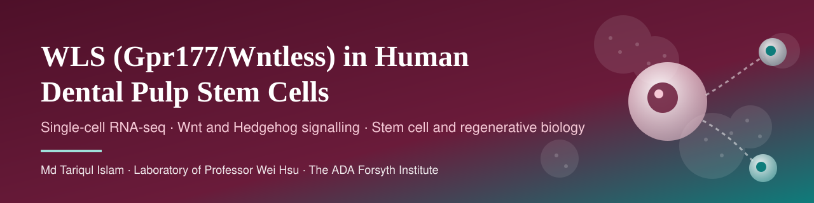
</p>

<p align="center">
  <a href="https://www.r-project.org/"></a>
  <a href="https://satijalab.org/seurat/"></a>
  
  
  
  
  
  <a href="https://www.ncbi.nlm.nih.gov/geo/"></a>
  <a href="renv.lock"></a>
  <a href="LICENSE"></a>
  
  
</p>

# WLS (Gpr177/Wntless) and Wnt/Hedgehog genes in human dental pulp stem cells

**Author:** Md Tariqul Islam · Laboratory of Professor Wei Hsu, The ADA Forsyth Institute, Somerville, MA, USA
**Discovery analysis:** [mtariqi/dpsc-wls-human-scRNAseq](https://github.com/mtariqi/dpsc-wls-human-scRNAseq) (GSE164157, 5 donors)
**Script index:** [`docs/SCRIPTS.md`](docs/SCRIPTS.md)

**Question (Prof. Wei Hsu):** Is Gpr177/Wntless (*WLS* in human) expressed in, and enriched in, the dental pulp stem cell (DPSC) population? Follow-up questions mapped the Wnt target *AXIN2* and the Hedgehog pathway genes *GLI1*, *PTCH1*, *PTCH2*, *SMO* and *HHIP* in the same cells.

## Contents

- [Datasets](#datasets)
- [Key findings](#key-findings)
- [1. WLS in DPSCs across four datasets](#1-wls-in-dpscs-across-four-datasets)
- [2. WLS in Axin2⁺ pulp cells (lab definition of DPSCs)](#2-wls-in-axin2-pulp-cells-lab-definition-of-dpscs)
- [3. Wnt and Hedgehog target genes](#3-wnt-and-hedgehog-target-genes)
- [4. Hedgehog receptors PTCH1, PTCH2 and SMO in Axin2⁺ pulp cells](#4-hedgehog-receptors-ptch1-ptch2-and-smo-in-axin2-pulp-cells)
- [Methods](#methods)
- [Run the analysis](#run-the-analysis)
- [Repository structure](#repository-structure)

## Datasets

| Dataset | Tissue | Comparison | Donors | Cells analysed |
|---|---|---|---|---|
| [GSE164157](https://www.ncbi.nlm.nih.gov/geo/query/acc.cgi?acc=GSE164157) | Fresh pulp | DPSCs vs other pulp cells | 5 | 23,174 |
| [GSE202476](https://www.ncbi.nlm.nih.gov/geo/query/acc.cgi?acc=GSE202476) | Fresh pulp, 13-year-old, immature third molar | DPSCs vs other pulp cells | 1 | 11,298 |
| [GSE185222](https://www.ncbi.nlm.nih.gov/geo/query/acc.cgi?acc=GSE185222) | Fresh pulp; sound tooth (DTP_01) used | DPSCs vs other pulp cells | 1 | 887 (sound tooth) |
| [GSE227731](https://www.ncbi.nlm.nih.gov/geo/query/acc.cgi?acc=GSE227731) ([PRJNA946721](https://www.ncbi.nlm.nih.gov/bioproject/PRJNA946721)) | Cultured DPSCs and PDLSCs | DPSCs vs PDLSCs | 1 library each | 4,015 |

## Key findings

1. **WLS is expressed in DPSCs in all four datasets** (11–70% of cells), and also in pulp fibroblasts, myeloid, glial and endothelial cells.
2. **Stem-score (perivascular) DPSCs are not enriched for WLS** (GSE164157: log2FC −0.14, FDR 0.57).
3. **Under the lab's definition (Axin2⁺ non-perivascular pulp cells; Yoshida et al. 2025), DPSCs have the most WLS⁺ cells** (30.8% vs 20.6%; 61.1% vs 49.9%), a consistent trend that is **not significant after adjusting for sequencing depth** (odds ratios 1.43 and 1.19).
4. **The Hedgehog targets PTCH1 and GLI1 are mainly in non-perivascular pulp cells**, clearest in the young tooth.
5. **In the young tooth, Axin2⁺ pulp cells express the Hedgehog receptor PTCH1 (63.5%) and transducer SMO (33.2%)** more often than Axin2⁻ pulp cells (45.5% and 27.3%); PTCH2 is rare (≈ 3%).

All comparisons except the GSE164157 pseudobulk test are descriptive (one donor or library per group).

---

## 1. WLS in DPSCs across four datasets

| Dataset | Comparison | DPSCs | % WLS⁺ DPSC | % WLS⁺ comparison | log2FC | p | Test | Enriched? |
|---|---|---|---|---|---|---|---|---|
| GSE164157 | DPSC vs all other cells | 2,847 | 11.1 | – | −0.14 | 0.57 (FDR) | pseudobulk edgeR, 5 donors | No |
| GSE185222 (sound tooth) | DPSC vs all other cells | 122 | 14.8 | 16.9 | +0.21 | 0.71 | descriptive, 1 donor | No |
| GSE202476 | DPSC vs all other cells | 1,011 | 33.8 | 36.7 | −0.16 | 0.14 | descriptive, 1 donor | No |
| GSE227731 | DPSC vs PDLSC | 2,150 | 69.5 | 83.7 | −0.72 | 3.6e-59 | descriptive, 1 library each | No (lower than PDLSC) |

% WLS⁺ differs between datasets because of sequencing depth, chemistry and culture; compare groups *within* a dataset. Full table: [`results/WLS_cross_dataset_summary.csv`](results/WLS_cross_dataset_summary.csv).

<p align="center">
  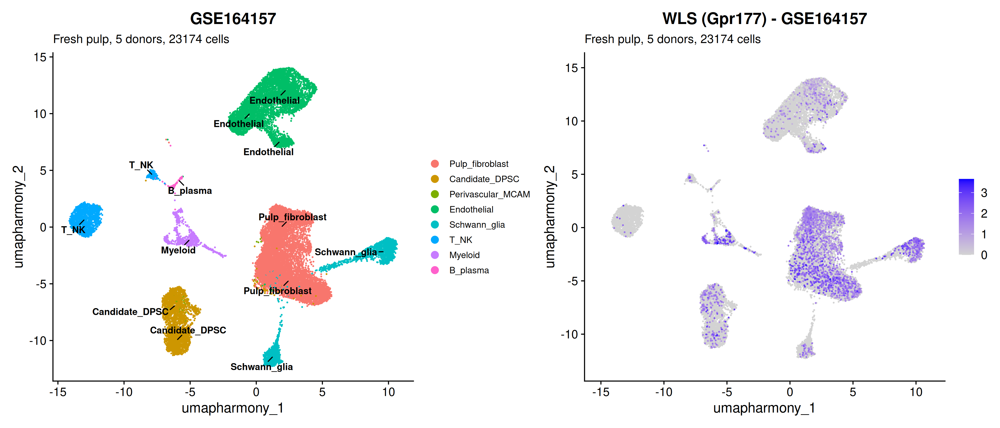<br>
  <em>GSE164157: cell types (left) and WLS expression (right).</em>
</p>

<p align="center">
  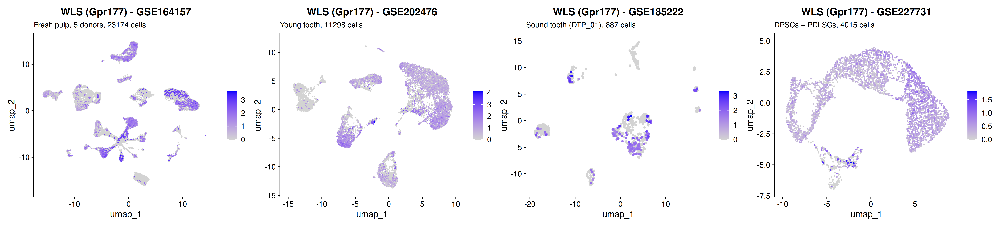<br>
  <em>WLS expression in all four datasets.</em>
</p>

## 2. WLS in Axin2⁺ pulp cells (lab definition of DPSCs)

Following [Yoshida et al. 2025](https://doi.org/10.1177/00220345251378094), DPSCs were also defined as **Axin2⁺ cells among non-perivascular pulp cells**.

| Dataset | Axin2⁺ / Axin2⁻ pulp cells | % WLS⁺ (Axin2⁺ vs Axin2⁻) | Odds ratio, unadjusted | Odds ratio, depth-adjusted (95% CI) |
|---|---|---|---|---|
| GSE164157 (5 donors) | 56 / 9,541 | 30.8 vs 20.6 (median of donors) | 1.81 (p = 0.048) | 1.43 (0.77–2.67), p = 0.25 |
| GSE202476 | 301 / 5,225 | 61.1 vs 49.9 | 1.58 (p = 0.0002) | 1.19 (0.92–1.52), p = 0.18 |
| GSE185222 (sound tooth) | 3 / 479 | – | not tested | not tested |

Tables: [`results/figures_for_Hsu/`](results/figures_for_Hsu/) (`*_WLS_by_Yoshida_groups.csv`, `*_Yoshida_depth_check.csv`).

<table>
  <tr>
    <td>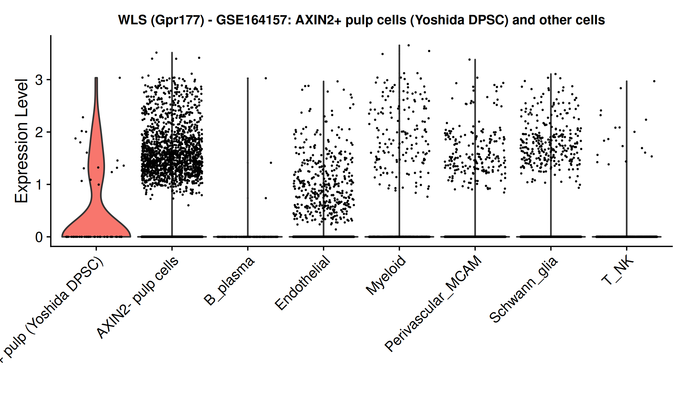</td>
    <td>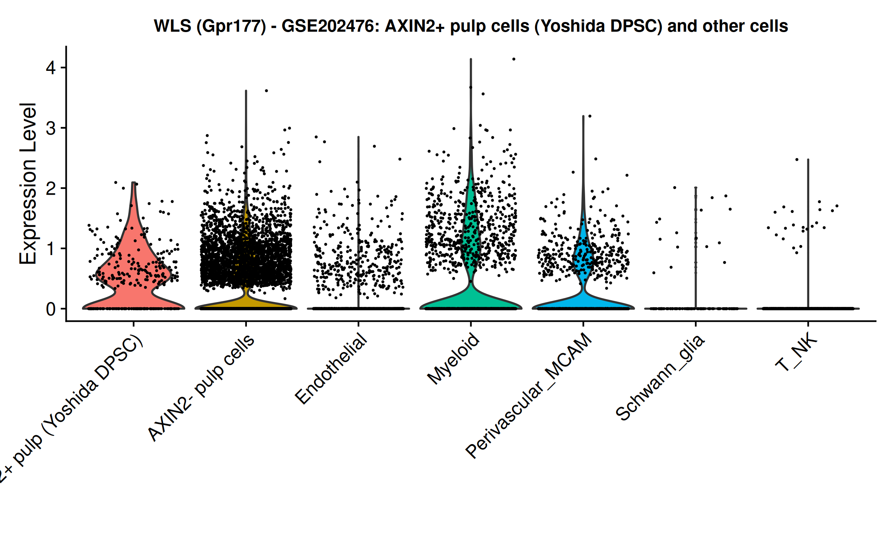</td>
  </tr>
  <tr>
    <td align="center"><em>GSE164157: WLS by group</em></td>
    <td align="center"><em>GSE202476: WLS by group</em></td>
  </tr>
</table>

## 3. Wnt and Hedgehog target genes

% of cells expressing each gene in the young tooth (GSE202476), where detection is clearest. Full table: [`results/figures_gene_panel/gene_panel_pct_expressing_by_group.csv`](results/figures_gene_panel/gene_panel_pct_expressing_by_group.csv).

| Gene | Pulp fibroblast | Candidate DPSC (stem score) | Endothelial | Schwann/glia |
|---|---|---|---|---|
| PTCH1 | 46.5 | 19.5 | 11.2 | 11.1 |
| GLI1 | 12.1 | 2.0 | 0.7 | 0.0 |
| AXIN2 | 5.4 | 2.8 | 4.1 | 2.8 |
| HHIP | 0.2 | 0.0 | 0.1 | 0.0 |

In the adult datasets these genes are detected in ≤ 4.3% of cells of any type; HHIP is essentially undetected and is not in the GSE227731 matrix.

<p align="center">
  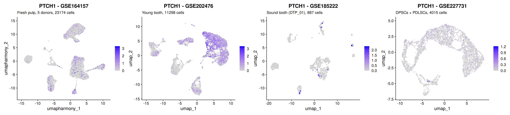<br>
  <em>PTCH1 in all four datasets.</em>
</p>

## 4. Hedgehog receptors PTCH1, PTCH2 and SMO in Axin2⁺ pulp cells

| Gene | Dataset | % Axin2⁺ pulp | % Axin2⁻ pulp |
|---|---|---|---|
| PTCH1 | GSE202476 (young tooth) | **63.5** (301 cells) | 45.5 (5,225 cells) |
| SMO | GSE202476 | **33.2** | 27.3 |
| PTCH2 | GSE202476 | 2.7 | 2.6 |
| PTCH1 | GSE164157 (adult, 5 donors) | 1.8 (56 cells) | 1.6 (9,541 cells) |
| PTCH2 | GSE164157 | 3.6 | 0.7 |
| SMO | GSE164157 | 0 | 1.2 |

Table: [`results/figures_composite/composite_pct_expressing_by_Yoshida_group_PTCH1_PTCH2_SMO.csv`](results/figures_composite/composite_pct_expressing_by_Yoshida_group_PTCH1_PTCH2_SMO.csv). All 12 figures (PNG and PDF): [`results/figures_composite/individual/`](results/figures_composite/individual/).

<table>
  <tr>
    <td>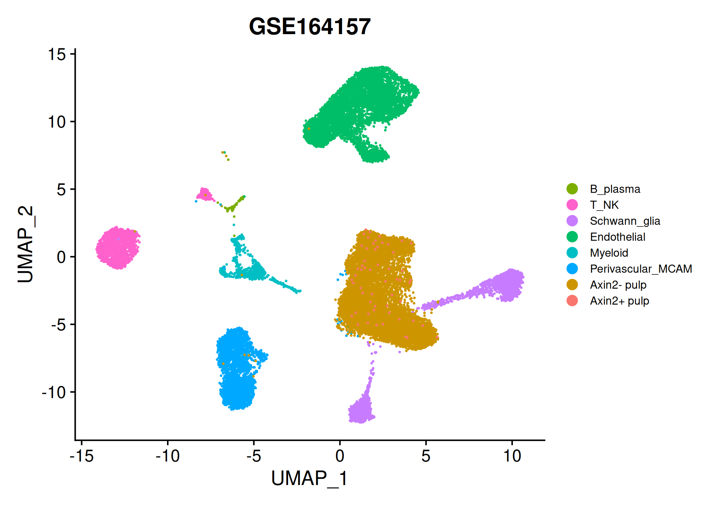</td>
    <td>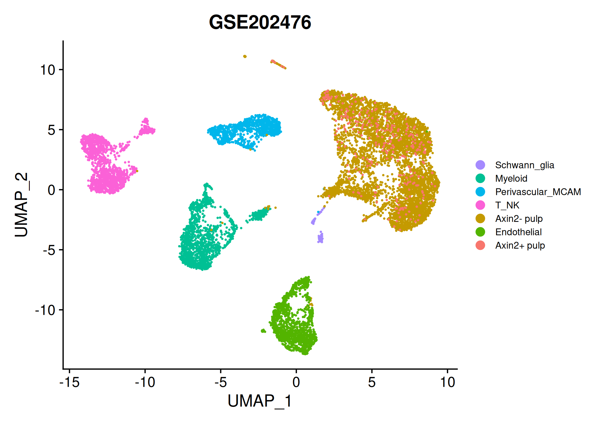</td>
  </tr>
  <tr>
    <td align="center"><em>GSE164157: cell groups</em></td>
    <td align="center"><em>GSE202476: cell groups</em></td>
  </tr>
  <tr>
    <td>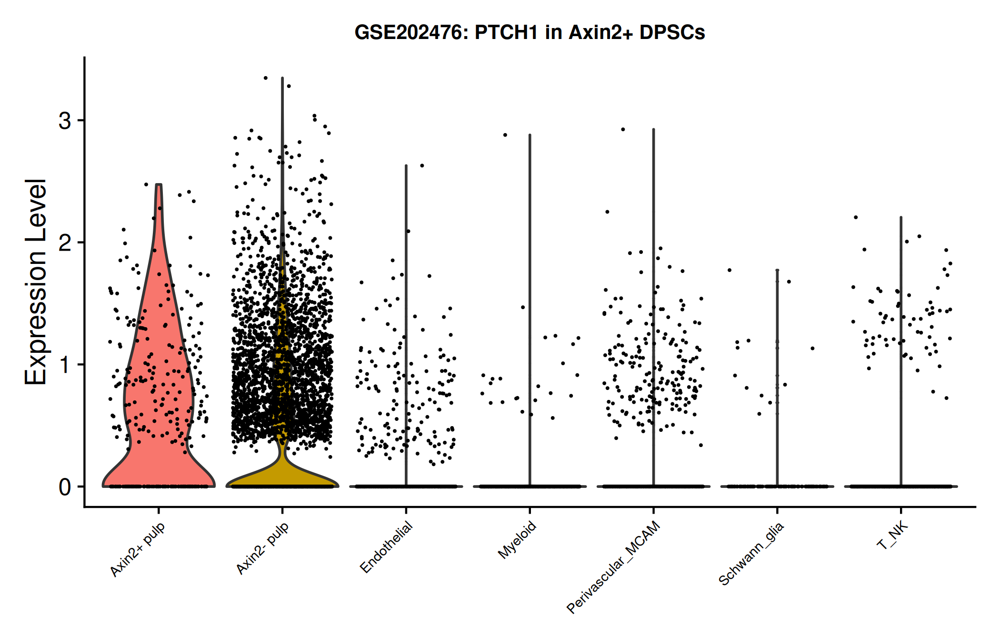</td>
    <td>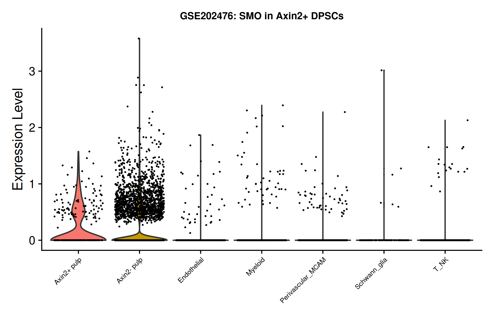</td>
  </tr>
  <tr>
    <td align="center"><em>GSE202476: PTCH1</em></td>
    <td align="center"><em>GSE202476: SMO</em></td>
  </tr>
  <tr>
    <td>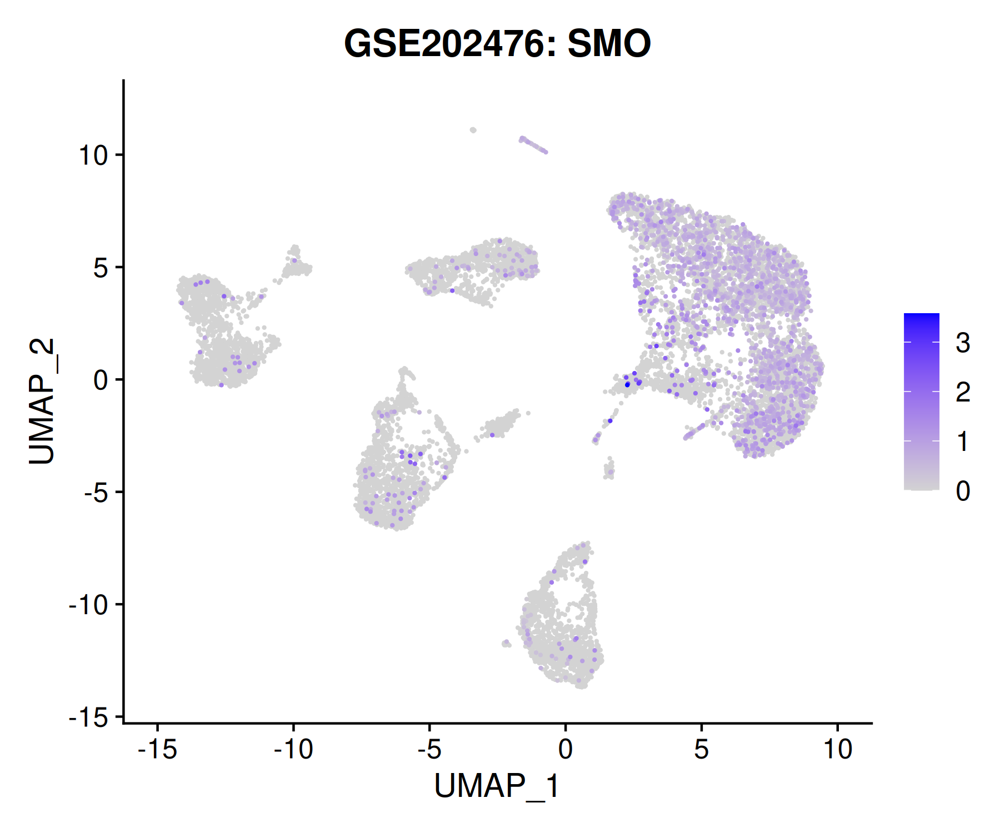</td>
    <td>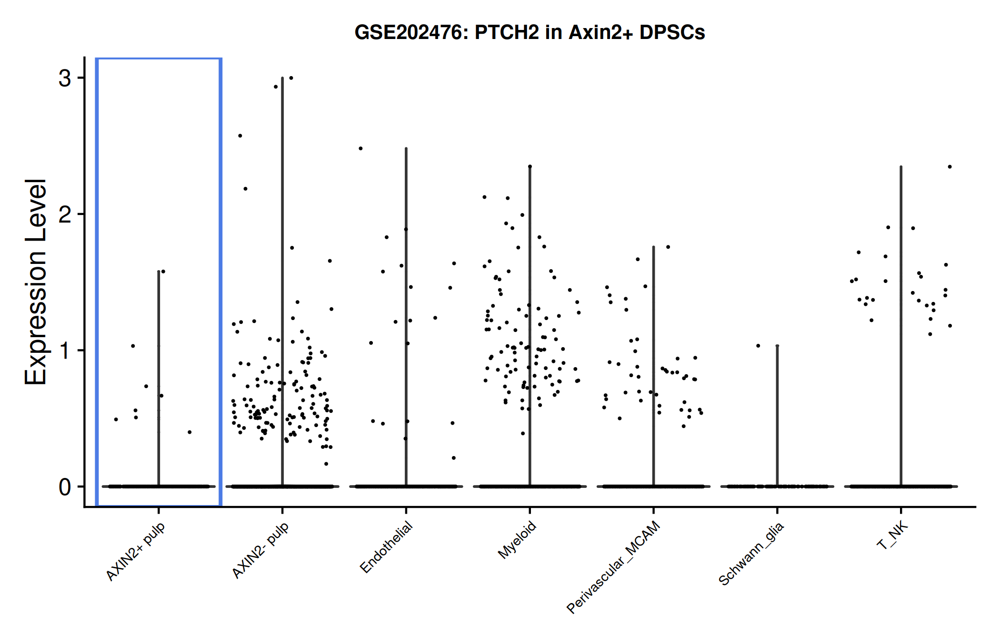</td>
  </tr>
  <tr>
    <td align="center"><em>GSE202476: SMO UMAP</em></td>
    <td align="center"><em>GSE202476: PTCH2</em></td>
  </tr>
</table>

---

## Methods

- **QC:** genes > 200, UMIs > 500, mitochondrial reads < 20%; doublets removed per sample with scDblFinder; Harmony integration by sample when there is more than one.
- **Cell types:** marker-panel module scores (Seurat `AddModuleScore`), confirmed manually; Yoshida et al. (2025) marker panels as an independent check.
- **DPSCs:** (A, primary) mesenchymal sub-clusters (Harmony dims 1–15, resolution 0.4) with mean stem score above background; (B) top 20% stem score; (C) ≥ 3 stem markers; (D) MCAM⁺; (Yoshida) Axin2⁺ non-perivascular pulp cells.
- **Statistics:** ≥ 3 donors: edgeR quasi-likelihood pseudobulk (~ donor + group). Fewer donors: % expressing cells, pooled log2FC and cell-level Wilcoxon, reported as descriptive. Axin2⁺ vs Axin2⁻: logistic regression with and without log10(UMIs per cell).
- **Environment:** R 4.6, Seurat 5.6.0; exact package versions in [`renv.lock`](renv.lock).

## Run the analysis

```bash
Rscript scripts/00_install_packages.R
Rscript scripts/01_download_data.R
Rscript scripts/02_preprocess.R GSE202476            # repeat for GSE185222, GSE227731
Rscript scripts/03_WLS_analysis.R GSE202476          # repeat for GSE185222, GSE227731
Rscript scripts/04_summary_table.R
Rscript scripts/05_figures_for_Hsu.R  <GSE164157_annotated.rds>
Rscript scripts/06_gene_panel_figures.R <GSE164157_annotated.rds> "GLI1,PTCH1,HHIP,AXIN2"
Rscript scripts/07_composite_figures.R  <GSE164157_annotated.rds> "PTCH1:violin,PTCH2:umap_violin,SMO:umap_violin"
```

`<GSE164157_annotated.rds>` is produced by the discovery repository (`scripts/06_annotation.R`). Each script has a header describing its purpose, inputs, outputs and usage; see [`docs/SCRIPTS.md`](docs/SCRIPTS.md).

## Repository structure

```text
dpsc-wls-validation/
├── config/validation_datasets.yaml     # datasets, QC thresholds, reference values
├── R/wls_validation_functions.R        # shared functions
├── scripts/00-07                       # analysis scripts, run in order
├── tools/                              # header and style tools
├── data/metadata/, data/annotation/    # sample sheets, confirmed cluster labels
├── docs/                               # SCRIPTS.md, validation plan, figure notes
└── results/
    ├── WLS_cross_dataset_summary.csv   # section 1
    ├── <GEO>/                          # per-dataset WLS tables and figures
    ├── figures_for_Hsu/                # section 2: cell types, Yoshida groups, depth check
    ├── figures_gene_panel/             # section 3: GLI1, PTCH1, HHIP, AXIN2
    └── figures_composite/              # section 4: PTCH1, PTCH2, SMO (12 figures)
```

Raw downloads and `.rds` objects are not tracked; running the scripts in order regenerates every result.

## Scope and limitations

The analysis answers expression questions only; DEG, GSEA and pathway analyses are out of scope. Three datasets have one donor or library per group, Axin2⁺ cells are few, DPSCs are defined computationally, mouse-derived markers are applied to human pulp, and all data are RNA only.

## 👥 Team

| Role | Name | Affiliation |
|---|---|---|
| Investigator | **Md Tariqul Islam** | The ADA Forsyth Institute |
| Supervisor | **Professor Wei Hsu** | The ADA Forsyth Institute |

## 🙏 Acknowledgments

Thanks to the authors of the original dental pulp single-cell studies for depositing their data publicly, and to the developers of Seurat, Harmony, scDblFinder, edgeR, lme4, Bioconductor, GEOquery, and renv.

## 📖 Citation

Use the **"Cite this repository"** button on the right (generated from [`CITATION.cff`](CITATION.cff)), or:

```bibtex
@software{islam2026wlsdpsc,
  author  = {Islam, Md Tariqul},
  title   = {dpsc-wls-human-scRNAseq: WLS (GPR177/Wntless) expression in candidate human dental pulp stem cells},
  year    = {2026},
  version = {1.0.0},
  url     = {https://github.com/mtariqi/dpsc-wls-human-scRNAseq}
}
```

Please also cite the original publication associated with [GSE164157](https://www.ncbi.nlm.nih.gov/geo/query/acc.cgi?acc=GSE164157).

## Citation and licence
- **Cite** via [`CITATION.cff`](CITATION.cff).
- **Code** (`scripts/` and other code): [MIT](LICENSE)
- **Reports, figures and tables** (`docs/`, `results/`, `assets/`): [CC BY 4.0](LICENSE-docs.md)
- **Data**: GSE164157 is not redistributed and remains subject to its original terms.

---

<div align="center">
<sub>Last updated: October 2, 2026 · Built with 🧬 R, Seurat and a lot of single cells</sub>
</div>


